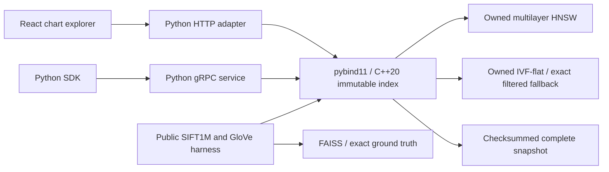

# Atlas

Atlas makes the recall, latency and memory cost of an owned vector-search index inspectable.

## Result

SIFT1M: **96.15% recall@10 at 5,729 queries/s**, HNSW ef=80, full 1,000,000-vector base and 200 test queries.  
GloVe: **81.20% recall@10 at 2,670 queries/s**, HNSW ef=200, full 1,183,514-vector base and 200 test queries.  
SIFT combined HNSW+IVF build: **155.89 s; 664.09 allocated bytes/vector**, one shared vector matrix; allocator, Python and thread scratch excluded. [Raw runs and FAISS comparison](docs/results/BENCHMARK.md).

## Architecture



## Run it

C++20 compiler, CMake, Python with venv/headers and Node/npm are prerequisites. Demo uses synthetic data; public downloads are separate.

```sh
make demo
# Open http://127.0.0.1:8094 and locate neighbors; Ctrl-C stops it.
make lint test bench
```

`make bench` downloads hash-pinned public files and runs a subset smoke comparison. Reproduce the recorded full corpus with the command in [DEMO.md](docs/DEMO.md). The gRPC SDK example, real recording and responsive browser proof are linked there. Deployment is prepared only; **not deployed**.

## Decisions and limits

Contextual motion uses finite transform-only responses to real controls and changed evidence, with live reduced-motion cancellation. See [motion design and validation](docs/MOTION.md); frame rate is not measured.


- Immutable C++ core, SIMD NEON/SSE2, portable persistence; Python implements the gRPC boundary. Filtered HNSW explicitly falls back to exact eligible search. IVF filtering remains approximate within probed lists. [Design](docs/DESIGN.md), [ADRs](docs/adr/).
- The measured curves include FAISS and every timing trial. At equal ef on SIFT, FAISS records 94.95% recall and 6,764 QPS; on GloVe ef=200, 80.55% and 2,593 QPS. Equal effort does not mean equal recall. Atlas's simple IVF baseline is much slower; the complete curves retain that result. No general speed advantage is claimed.
- Single-thread single-query binding calls; network excluded. This development laptop had background work and uncontrolled power/cache state. Large trial spreads remain visible. The fixed leading test-query sample does not establish general workload performance. Service QPS and internet latency are **not measured**.
- Atlas capacity accounting includes both indexes. FAISS serialized bytes are a different scope; neither is isolated RSS, and no memory-efficiency winner is claimed. Build strategies and training samples differ.
- A checksummed snapshot detects accidental corruption, not malicious forgery or power-loss durability. [Caught corruption](docs/results/core-tests.log), [caught clean-clone download failure](docs/results/caught-fresh-download-403.log), [caught container test ownership issue](docs/results/caught-container-ci.log). The browser's ambiguous-label failure is retained and corrected too.
- Local bearer-authenticated demo, bounded workers/messages; gRPC is loopback-only plaintext. Remote TLS, multi-tenant auth, cancellation/preemption and internet operations are outside this local scope. No company usage is claimed. Public/synthetic data only.

## Next

Compact graph arenas and isolated heap/RSS measurements; broader randomized query samples with idle-machine timing; filtered ANN with measured exact-fallback thresholds; authenticated snapshot publication; cooperative cancellation, TLS and update/rebuild rollout. [Quality report](docs/QUALITY.md), [interview kit](INTERVIEW.md), [follow-up drill](DRILL.md), [salvage record](docs/migration/atlas.md).
