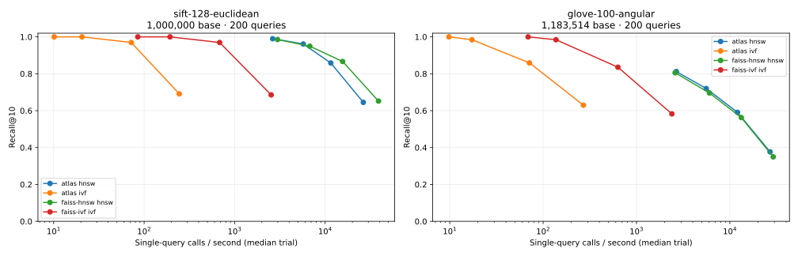

# Public corpus benchmark

Generated by `scripts/render_readme.py` from raw JSON. Both complete base corpora; fixed leading test queries. Single-query Python/native calls, three warm trials. Median trial QPS. This is an uncontrolled development laptop: background build/browser activity is disclosed, and all trials are retained. Network/service performance is not measured.

## sift-128-euclidean

1,000,000 base vectors, 128 dimensions, 200 queries. squared L2.

| Engine | Algorithm | Effort | Recall@10 | QPS median | QPS trials | p50 / p99 ms |
|---|---|---:|---:|---:|---|---|
| atlas | hnsw | 10 | 0.6450 | 26,433 | 2,151, 26,433, 31,990 | 0.0379 / 1.0345 |
| atlas | hnsw | 32 | 0.8585 | 11,544 | 4,822, 11,544, 12,843 | 0.0858 / 0.3435 |
| atlas | hnsw | 80 | 0.9615 | 5,729 | 4,414, 5,729, 5,921 | 0.1806 / 0.3326 |
| atlas | hnsw | 200 | 0.9900 | 2,632 | 2,586, 2,665, 2,632 | 0.3796 / 0.6122 |
| atlas | ivf | 1 | 0.6910 | 244 | 240, 285, 244 | 3.5833 / 13.1658 |
| atlas | ivf | 4 | 0.9695 | 72 | 71, 72, 74 | 13.4171 / 31.7507 |
| atlas | ivf | 16 | 1.0000 | 21 | 20, 21, 21 | 48.7275 / 53.9677 |
| atlas | ivf | 32 | 1.0000 | 10 | 10, 10, 10 | 98.3321 / 105.2662 |
| faiss-hnsw | hnsw | 10 | 0.6520 | 38,897 | 15,562, 38,897, 41,214 | 0.0273 / 0.1082 |
| faiss-hnsw | hnsw | 32 | 0.8665 | 15,612 | 12,085, 15,612, 16,335 | 0.0634 / 0.1210 |
| faiss-hnsw | hnsw | 80 | 0.9495 | 6,764 | 6,179, 7,013, 6,764 | 0.1525 / 0.2255 |
| faiss-hnsw | hnsw | 200 | 0.9855 | 2,982 | 2,934, 2,982, 3,113 | 0.3285 / 0.4813 |
| faiss-ivf | ivf | 1 | 0.6855 | 2,533 | 2,533, 2,311, 2,554 | 0.3675 / 1.1323 |
| faiss-ivf | ivf | 4 | 0.9695 | 682 | 663, 682, 710 | 1.4080 / 2.3847 |
| faiss-ivf | ivf | 16 | 1.0000 | 193 | 193, 194, 183 | 5.0911 / 7.5464 |
| faiss-ivf | ivf | 32 | 1.0000 | 85 | 87, 85, 81 | 11.0327 / 22.7832 |

| Build | Seconds | Bytes/vector | Memory scope |
|---|---:|---:|---|
| atlas | 155.89 | 664.09 | C++ capacities incl both indexes, vectors once; excludes allocator/scratch/Python |
| faiss-hnsw | 130.36 | 624.36 | FAISS serialized bytes, not heap/RSS; separate index |
| faiss-ivf | 0.38 | 520.02 | FAISS serialized bytes, not heap/RSS; separate index |

[Raw source and every trial](sift-128-euclidean-1000000.json)

## glove-100-angular

1,183,514 base vectors, 100 dimensions, 200 queries. squared L2 on unit vectors (cosine ranking).

| Engine | Algorithm | Effort | Recall@10 | QPS median | QPS trials | p50 / p99 ms |
|---|---|---:|---:|---:|---|---|
| atlas | hnsw | 10 | 0.3765 | 26,962 | 3,572, 26,962, 32,638 | 0.0362 / 0.8345 |
| atlas | hnsw | 32 | 0.5910 | 12,060 | 8,174, 12,174, 12,060 | 0.0845 / 0.2295 |
| atlas | hnsw | 80 | 0.7200 | 5,584 | 5,584, 5,458, 5,609 | 0.1732 / 0.3517 |
| atlas | hnsw | 200 | 0.8120 | 2,670 | 2,738, 2,670, 2,579 | 0.3758 / 0.5669 |
| atlas | ivf | 1 | 0.6295 | 270 | 277, 252, 270 | 3.6857 / 6.6889 |
| atlas | ivf | 4 | 0.8590 | 71 | 73, 71, 69 | 13.9465 / 23.5417 |
| atlas | ivf | 16 | 0.9845 | 17 | 18, 17, 16 | 55.9446 / 140.7851 |
| atlas | ivf | 32 | 1.0000 | 10 | 10, 9, 10 | 100.4012 / 181.9478 |
| faiss-hnsw | hnsw | 10 | 0.3495 | 29,133 | 2,608, 29,133, 36,428 | 0.0338 / 1.1337 |
| faiss-hnsw | hnsw | 32 | 0.5625 | 13,255 | 7,498, 13,255, 13,368 | 0.0808 / 0.2647 |
| faiss-hnsw | hnsw | 80 | 0.6955 | 6,043 | 5,073, 6,666, 6,043 | 0.1595 / 0.3396 |
| faiss-hnsw | hnsw | 200 | 0.8055 | 2,593 | 2,593, 2,551, 2,697 | 0.3718 / 0.6373 |
| faiss-ivf | ivf | 1 | 0.5825 | 2,393 | 1,992, 2,393, 2,420 | 0.4367 / 1.0044 |
| faiss-ivf | ivf | 4 | 0.8355 | 632 | 632, 630, 635 | 1.5542 / 2.2172 |
| faiss-ivf | ivf | 16 | 0.9845 | 137 | 150, 137, 130 | 6.5216 / 18.5293 |
| faiss-ivf | ivf | 32 | 1.0000 | 69 | 69, 65, 78 | 12.6824 / 34.7895 |

| Build | Seconds | Bytes/vector | Memory scope |
|---|---:|---:|---|
| atlas | 238.80 | 550.94 | C++ capacities incl both indexes, vectors once; excludes allocator/scratch/Python |
| faiss-hnsw | 195.70 | 512.38 | FAISS serialized bytes, not heap/RSS; separate index |
| faiss-ivf | 0.40 | 408.01 | FAISS serialized bytes, not heap/RSS; separate index |

[Raw source and every trial](glove-100-angular-1183514.json)

## Commentary

FAISS's IVF implementation is materially faster at comparable recall. Atlas's IVF scans data via scattered IDs and uses a simple bounded-sample training baseline. No SIMD speedup is claimed without a scalar/SIMD throughput benchmark: parity is tested, speedup is not measured. HNSW ef values govern different implementations and should be compared on recall/latency curves rather than equal-knob victory claims.

Atlas build time includes both indexes; FAISS's rows build each index separately. Native capacity accounting and FAISS serialized size differ and do not support a memory winner. Cumulative process high-water RSS rows are retained solely as process context, not per-index attribution. Full corpus refers to base vectors, not all available test queries. Reproduce with the exact full-corpus command in docs/DEMO.md.
